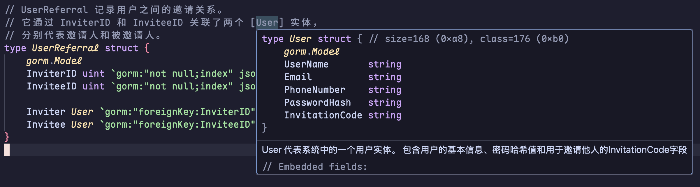

Golang中注释的基本语法不再赘述，本文介绍部分Golang注释中的特殊用法。

文中使用的工具环境为:

- 编辑器: VSCode / NeoVim
- LSP: gopls

<!-- more -->

## Links[^1]

在使用Golang的ORM框架（如GORM）时，可以通过在结构体字段上添加注释来描述数据库表之间的关联关系；

语法为: `[OtherStructName]`

### 示例

```go
// UserReferral 记录用户之间的邀请关系。
// 它通过 InviterID 和 InviteeID 关联了两个 [User] 实体，
// 分别代表邀请人和被邀请人。
type UserReferral struct {
	gorm.Model
	InviterID uint `gorm:"not null;index" json:"inviter_id"`
	InviteeID uint `gorm:"not null;index" json:"invitee_id"`

	Inviter User `gorm:"foreignKey:InviterID"`
	Invitee User `gorm:"foreignKey:InviteeID"`
}
```

### 效果

当鼠标悬停在`[User]`时，编辑器会显示`User`结构体的定义；此外也可以进行`Go To Definition`等操作。



[^1]: [Go Doc Comments - The Go Programming Language](https://go.dev/doc/comment#links)